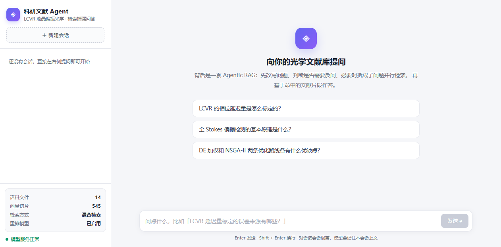
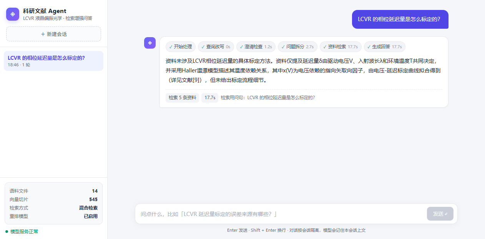

# 光学科研文献智能体 · Agentic RAG

> 面向**光学 / 液晶偏振测量（LCVR）**垂直领域的科研文献问答智能体。
> 不是「能跑通」的玩具——每一层优化都有**可复现的评测数字**兜底。
>
> **作者：代益泉**（GitHub [@dai428](https://github.com/dai428)）· 独立完成全部设计、实现与评测
> 📁 本机 `D:\Desktop\rag-demo` · 栈：LangGraph + LangChain + Chroma + BGE + FastAPI
> 📄 License: MIT（见 [LICENSE](LICENSE)）

---

## 零、作者与开发过程

**这个仓库从第一行代码到评测脚本，全部由我一个人完成。** 提交历史可核验：

| 开发日 | 提交数 | 做了什么 |
|---|---|---|
| **2026-10-08** | 6 | 从「纯向量 RAG」升级为 Agentic RAG：父子分层切块、混合检索（向量 + BM25 + RRF）、CrossEncoder 重排、澄清反问 / 问题拆分 / 并行检索 / 历史摘要 / 预算控制五项能力；随后补生成层评测（RAGAS）与可观测（Langfuse），再升级为 Vite + React 全栈应用（SSE 流式） |
| **2026-10-14** | 10 | 交付闭环：Phase 0 正确性修复（状态污染 / 包导入 / 重排方向）→ Phase 1-2 文档闭环与结构化引用 → Phase 3-4 引用卡片、Docker Compose、CI 门禁 → Phase 5 拒答阈值量纲标定；期间完成隐私清洗（移除未发表论文数据引用、`notes/` 移出仓库） |
| **2026-10-15** | 6 | 可复现性收口：消融探针入库、评测口径以实测统一、作者与开发过程落档、修复 Docker 构建对私有文件的历史依赖 |

- 全部提交的 author 均为 `dai428 <450644094@qq.com>`，无第三方作者痕迹：
  ```bash
  git log --all --pretty=format:"%an <%ae>" | sort -u   # 只有一行
  ```
  > 计数说明：`git log --all` 与 `git log main` 数字一致（分支已合并干净）。
  > 历史曾因 rebase 留下重复血统，2026-10-15 重写历史时已压平。
- 分阶段演进而非一次性导入：`feat` / `fix` / `chore` / `docs` 四类齐全，含真实排障提交
- 分阶段演进而非一次性导入：`feat` / `fix` / `chore` / `docs` 四类齐全，含真实排障提交
  （如 `fix: 修复 Phase 0 正确性问题（状态污染/包导入/配置/重排方向）`）。
- 评测数字均由本仓库脚本产出，可当场复现（见第三节）。

---

## 零之二、界面实拍（本地跑通后截图）

| 落地页 | 真实问答（含执行轨迹 + 引用） |
|---|---|
|  |  |

- 左图：侧栏实时显示语料规模（**15 篇 / 643 个向量切片 / 84 个父块**）、检索方式与重排状态。
- 右图：一次真实提问的完整执行轨迹——`开始处理 → 查询改写 0s → 澄清检查 1.2s →
  问题拆分 2.7s → 资料检索 17.7s → 生成回答 17.7s`，底部标出「检索 5 条资料」与改写后的检索问句。
- 第三张（流式中间态）：[03-streaming-stages.png](docs/screenshots/03-streaming-stages.png)

> ⚠️ 截图是**早期版本**拍摄的，侧栏显示「14 篇 / 545 切片」；当前语料已扩展到
> **15 篇 / 643 子块 / 84 父块**（以 `data/index_manifest.json` 为准）。两处均为实测值，
> 数字差异来自语料更新，不是截图伪造。

---

## 一句话卖点

**把 RAG 从「向量检索 + 拼接」升级为「有规划、会反问、能并行、可观测」的 Agentic RAG。**
在 20 题真实语料评测集上，检索层 Recall@5 从 **80% → 100%**，MRR@10 从 **0.616 → 0.783（+27.1%）**，未达标题从 **4 道 → 0 道**。

> 📌 一句话讲清「哪一层贡献了什么」：**混合检索**把 R@5 从 80% 抬到 85%（MRR 0.616→0.657）；
> **重排**再抬到 90%（MRR→0.793）；**扩大召回池到 25 + 来源加权**补上最后 10 pt 到 100%。
> 三步各自的可复现数字见第三节消融表。
>
> ⚠️ **一个必须说清的机制边界（实测，2026-10-16）**：混合检索的收益来自 **RRF 重排**，
> **不是召回扩展**。当前参数下 `dense_k = sparse_k = 25`、融合后又截断到 25 条，
> 而 sparse 单腿文档的分数上限 `0.4/(60+1)=0.00656` 低于 dense 单腿文档的下限
> `0.6/(60+25)=0.00706` —— 所以 **BM25 独有的文档必然排在 25 名之外被截断**。
> 对 20 题逐题比对：**融合结果集合与纯向量集合 20/20 完全相同**，BM25 新增召回为 0。
> 它仍提升了 R@1/MRR，因为两路重叠的文档被重新排了序。要让 BM25 真正扩召回，
> 应改为「融合后取并集（≤50）交给重排」，或降低 K0 / 提高 `sparse_weight`。
> 复现：`scripts/probe_bm25_recall.py`。

---

## 一、它解决什么问题

光学实验语料有三个「劝退向量检索」的特点：

| 语料特点 | 纯向量检索的后果 | 本项目的解法 |
|---|---|---|
| 大量 **Markdown 表格**（参数、扫描结果） | 表格被切片拦腰截断，数字检索不到 | **表格展开**：横竖两种平铺形式，让数字变成可检索文本 |
| 同一参数在 **论文体 / 实验记录 / 数据表** 中反复出现 | 叙述性文字字面重合度高，一手数据被挤后面 | **来源加权**：实验记录 ×1.03、论文体 ×0.97 |
| 术语精确（如「ΔCN」「DE 加权」），同义词少 | 纯语义召回想不起精确术语 | **混合检索**：向量 + BM25 双路召回 RRF 融合 |

---

## 二、架构

```
                        ┌─(闲聊)────────────→ respond → END
__start__ → rewrite ────┼─(问题模糊)───────→ clarify → END（把问题抛回用户）
                        └─(正常)──→ decompose ─┬─→ retrieve_one ─┐
                                                └─→ retrieve_one ─┴→ respond(reduce) → END
                               （Send 动态并行，子问题数 = 分支数）

检索链路：query → [向量 Top-25 + BM25 Top-25] → RRF 融合 → CrossEncoder 重排
                → 父块聚合 → 来源加权 → Top-5 父块 → 拼上下文
```

### 全栈形态：一次提问的完整链路

```
浏览器 (React)
  │  POST /api/chat/stream   { message, session_id }
  ▼
FastAPI ── 驱动 graph.astream(stream_mode=["updates", "messages", "custom"])
  │
  │  SSE 事件（前端按 event 名分发）：
  │    stage    某节点跑完（含耗时）        → 时间轴打勾
  │    pending  预告「下一步在做什么」      → 时间轴显示进行中，填补几十秒空窗
  │    token    逐字输出（按节点过滤）      → 打字机效果
  │    reset    重试了，作废已显示内容      → 清空气泡（避免答案重复）
  │    done     权威答案 + 元信息           → 覆盖流式拼接的结果
  │    error    出错                       → 气泡下方红字提示
  ▼
浏览器渲染（消息 + 执行轨迹 + 元信息）
```

**为什么 token 要按节点过滤？** 图里 6 个节点都调大模型，但只有真正产出答案的
`clarify` / `respond` 该给用户看；`rewrite`、`clarify_check`、`decompose` 的输出是内部
中间产物（比如「清晰」两个字）。`retrieve_one` 仅在问题**未被拆分**时才推 ——
单问题路径的最终答案就在这个节点生成；多子问题时会并行跑多个分支，token 会交错串台，
必须等 `respond` 汇总（reduce）后再推。

### 六个 Agentic 能力（都对应一个真实痛点）

| 能力 | 节点 | 解决什么 |
|---|---|---|
| **查询改写** | `rewrite` | 多轮对话里的「它 / 那个结果」补全成独立问句 |
| **澄清反问** | `clarify_check` | 问题太模糊时**先反问**，不瞎猜（避免自信地答错） |
| **问题拆分** | `decompose` | 「对比 A 和 B」自动拆成两个子问题 |
| **并行检索** | `Send` + `retrieve_one` | 子问题同时检索，再 reduce 汇总 |
| **历史摘要** | `_summarize` | 长对话滚动压缩，控 token 且不丢数字 |
| **预算控制** | `MAX_TOOL_CALLS` 等 | 硬上限，防止 Agent 陷入检索死循环 |

---

## 三、评测结果（可复现）

评测集：`data/eval_set.json` —— **20 题**真实光学语料问题，每题标注期望来源文件与关键词。

| 指标 | 旧版（纯向量） | 新版（混合+重排） | 提升 |
|---|---|---|---|
| Recall@1 | 50.0% | **65.0%** | +15.0 pt |
| **Recall@5** | 80.0% | **100.0%** | **+20.0 pt** |
| Recall@10 | 95.0% | **100.0%** | +5.0 pt |
| MRR@10 | 0.616 | **0.783** | **+27.1%** |
| NDCG@10 | 0.647 | **0.805** | **+24.4%** |
| 关键词命中@5 | 85.0% | **95.0%** | +10.0 pt |
| **未达标（R@5 未命中）** | 4 | **0** | — |

### 优化贡献分解（每一步都单独实测）

> ⚠️ **这张表是「关掉某个特性重跑」的消融结果**，不是分阶段开发时的历史数字。
> 复现：`scripts/probe_ablation.py`（同一份代码 + 同一套 20 题评测集）。
> 来源加权单独消融：`scripts/probe_source_prior.py`。
> 说明：**表格展开已实现在 `chunker.py` 内、无法单独开关**，因此不再单列为一个可测步骤
> （早期版本曾给出过它的中间值，那个值在当前代码上不可复现，已移除）。
> 另：**来源加权只在开启重排时生效**（权重乘在重排分数上，见 `knowledge_base.py` 的 `rerank`），
> 关闭重排后它与「混合召回」是同一个配置 —— 故表中不单列「混合 + 来源加权（不重排）」。
> 下表每行都是**互不相同**的配置，可直接当消融步骤读。

| 步骤 | 做法 | R@1 | R@5 | MRR@10 |
|---|---|---|---|---|
| ① 基线 | 纯向量，chunk=300 | 50.0% | 80.0% | 0.616 |
| ② 混合召回 RRF | 向量 + BM25 | 50.0% | 85.0% | 0.657 |
| ③ 重排 + 加权 | 召回池仅 12 | 70.0% | 90.0% | **0.796** |
| ④ 重排（对照） | 召回池 25 · **关掉**来源加权 | 70.0% | 90.0% | **0.793** |
| ⑤ **重排 + 来源加权 ★** | 召回池 25 · 实验/总纲 ×1.03，论文体 ×0.97 | 65.0% | **100.0%** | **0.783** |

**来源加权的真实代价（④ → ⑤，实测）**：

| 指标 | 关掉加权 | 开启加权 | 变化 |
|---|---|---|---|
| Recall@1 | 70.0% | 65.0% | **−5.0 pt** |
| Recall@5 | 90.0% | **100.0%** | **+10.0 pt** |
| MRR@10 | 0.793 | 0.783 | −0.010 |
| NDCG@10 | 0.802 | 0.805 | **+0.003** |

> **取舍要说全（三个代价，不只一个）**：来源加权把 R@5 从 90% 补到 100%（+10 pt）、NDCG 微升，
> 代价是 MRR −0.010 **且 R@1 掉了 5 个点**（70%→65%）。
> 划算的原因：本系统的下游是「拼上下文给大模型 + 答案必须标出处」，
> **正确文档只要掉出前 5，模型就看不到它**——所以「必在前 5」是硬需求，排序略微下滑可接受。
> 系数来源与边界（**如实说明**）：`1.03 / 0.97` 只做过「开启 vs 关闭」的消融
> （`scripts/probe_source_prior.py`），**没有做系数网格搜索** —— 仓库里不存在扫描 1.08/0.92 的代码。
> 因此这两个具体数字属于先验选择，其在其他语料上的最优性未经验证。

### 生成层评测（RAGAS，抽样 5 题）

检索好不等于回答好。用 RAGAS 对生成质量做抽查（裁判模型 = 本项目的 DeepSeek-V4-Flash）：

| 指标 | 含义 | 得分 |
|---|---|---|
| **faithfulness** | 答案的每句陈述能否在检索资料里找到依据（**衡量幻觉**） | **0.889** |
| **answer_relevancy** | 答案是否正面回应用户的问题（衡量跑题） | **0.818** |

> 说明：因 `eval_set.json` 是检索评测集（无逐题标准答案），只用不需要 `reference` 的两个指标。
> 且裁判模型与被评模型相同（自评），**绝对分值仅供参考，横向对比才有意义**。

复现命令：

```bash
cd app
../.venv/Scripts/python.exe eval_rag.py --compare   # 三种检索模式对比
../.venv/Scripts/python.exe eval_gen.py --limit 5   # 生成层评测（RAGAS）
../.venv/Scripts/python.exe verify_p1.py             # P1 四项行为验证
```

---

## 四、目录结构

```
rag-demo/
├─ app/                      # ⭐ 后端核心代码
│  ├─ chunker.py             #    父子分层切块 + 表格展开 + 父块仓库
│  ├─ knowledge_base.py      #    混合检索(RRF) + CrossEncoder 重排 + 来源加权
│  ├─ rag_graph.py           #    ⭐ LangGraph 主图（6 能力全在这）
│  ├─ rag_agent.py           #    create_agent 黑盒版（对照用：框架 vs 手写）
│  ├─ state.py               #    图状态定义（含并行 reducer）
│  ├─ prompts.py             #    全部提示词集中管理
│  ├─ config.py              #    全部可调参数集中管理
│  ├─ main.py                #    FastAPI 服务（含 SSE 流式 + 前端静态托管）
│  ├─ eval_rag.py            #    检索层评测（三模式对比）
│  ├─ eval_gen.py            #    生成层评测（RAGAS）
│  ├─ verify_p1.py           #    Agentic 行为验证
│  └─ test_rag.py            #    服务链路测试
├─ frontend/                 # ⭐ 前端（Vite + React + TypeScript）
│  ├─ src/
│  │  ├─ App.tsx             #    会话管理 + 流式状态编排 + 本地持久化
│  │  ├─ api.ts              #    接口封装（含手写 SSE 解析）
│  │  ├─ types.ts            #    与后端返回一一对应的类型
│  │  ├─ markdown.tsx        #    轻量富文本渲染（不引 markdown 依赖）
│  │  └─ components/         #    Sidebar / ChatPanel / MessageBubble / StageTrail
│  ├─ vite.config.ts         #    开发期 /api 代理到 8000
│  └─ dist/                  #    构建产物（由 FastAPI 托管，已 .gitignore）
├─ data/
│  ├─ docs/{论文,实验报告,表格}/  # 语料（15 篇，未发表材料，已 .gitignore）
│  ├─ chroma_db/             #    向量库（可重建，643 个子块）
│  ├─ parent_store/          #    父块 JSON（84 个）
│  └─ eval_set.json          #    评测集（20 题，未入库；仓库放脱敏样例）
├─ learn/  notes/  legacy/   # 学习资料 / 讲解 HTML / 旧脚本
├─ .env.example              # 配置模板（不含密钥）
└─ Dockerfile / .dockerignore
```

---

## 五、快速开始

### 1) 装依赖

```bash
cd D:/Desktop/rag-demo
python -m venv .venv
./.venv/Scripts/python.exe -m pip install -r requirements.txt
```

### 2) 配密钥

```bash
cp .env.example .env
# 编辑 .env，填入 AMD_API_KEY
```

### 3) 建索引（首次或语料变更后）

```bash
cd app
../.venv/Scripts/python.exe -c "import knowledge_base as kb; kb.build_vectorstore(force=True)"
```

### 4) 构建前端

```bash
cd frontend
npm install
npm run build          # 产出 frontend/dist，由 FastAPI 自动托管（同源，无跨域）
```

> 开发前端时改用 `npm run dev`（起在 5173，由 Vite 把 `/api` 代理到 8000），
> 改代码即时热更新，不用反复 build。**改了前端要重新 build 才会体现在 8000 端口。**

### 5) 启动服务

```bash
cd ../app
../.venv/Scripts/python.exe -m uvicorn main:app --host 127.0.0.1 --port 8000
# → 聊天界面   http://127.0.0.1:8000
# → 接口文档   http://127.0.0.1:8000/docs
```

> 只想在命令行验证图逻辑（不起前端）：
> `../.venv/Scripts/python.exe rag_graph.py`

---

## 六、模型选型（实测结论）

AMD Radeon Cloud 各模型单次调用耗时（2026-10-08 实测）：

| 模型 | 耗时 | 建议 |
|---|---|---|
| MiniCPM5-2B | 0.9 s | 极快，质量偏弱 |
| Qwen3.8-Flash-Next | 2.1 s | 快且质量好 |
| **DeepSeek-V4-Flash** | **2.2 s** | ✅ **默认**：开发调试首选 |
| MiMo-V2.6-Flash | 2.5 s | 快 |
| DeepSeek-V4.1-Flash | >90 s | ⚠️ 易超时 |
| GLM-5.3-Flash | >90 s | ⚠️ 易超时 |
| Qwen3.8-27B | 60~360 s | 质量最好（推理模型），适合出正式报告 |

**结论**：日常开发用 flash 系（2 秒级），出报告换 27B。改 `.env` 里 `AMD_LLM_MODEL` 一行即可，不改代码。
换 27B 时记得同步调大 `config.py` 的 `request_timeout`（27B 需 600s，flash 系 120s 够）。

---

## 七、踩坑记录（真实排障过程）

这些坑都写进了代码注释，这里只列结论：

1. **`EnsembleRetriever` 已从 langchain-community 移除** → 自实现 RRF 融合（`_RRFRetriever`）。
2. **并行分支写同一字段抛 `InvalidUpdateError`** → 给 `tool_calls` 加 `sum_int` reducer、`iterations` 加 `last_int`。
   *（这个 bug 曾伪装成「模型超时」，排查了很久。）*
2.1 **同一个坑又踩一次：`abstained` / `abstain_reason` 漏了 reducer** → 单子问题提问时永远只有一个分支写，
   缺陷被掩盖；**库外的多子问题提问**会让两个分支同 step 各写一次，直接
   `InvalidUpdateError: At key 'abstained'` → 接口 500。修复：`abstained` 用 `or_bool`（任一为真即为真）、
   `abstain_reason` 用 `merge_abstain_reason`（去重排序，输出与并行顺序无关）。
   **教训**：给 State 加任何新字段时，先问「并行分支会不会同时写它」——没有 reducer 的字段在多分支图里都是定时炸弹；
   且回归测试必须用**多子问题**覆盖，单子问题测不出来。
2.2 **reducer 的重置信号不能用合法值充当**（2.1 的返工）→ 初版拿 `False` 当「新一轮重置」，
   但 `False` 同时是「我这支没拒答」的合法否定票，两种语义撞车后合并结果取决于分支写入顺序
   （`update([True, False])` → `False`），而并行顺序由调度决定 ⇒ 偶现的拒答丢失。
   改为 **`None` 作唯一重置哨兵**（只有 `begin_turn` 写），`False` 恢复为不抹掉同伴的普通投票。
   **教训**：reducer 会被逐个喂值，重置语义必须用一个不可能与真实取值冲突的哨兵。
2.3 **拒答状态跨轮污染** → `abstained=True` 会随 checkpointer 留在 state 里，`begin_turn` 不重置就会出现
   「这一轮明明检索到了证据，接口仍报 `abstained=True`」。修复：`begin_turn` 一并重置
   `abstained=None` / `abstain_reason=""` / `ungrounded_questions=[]`。
2.4 **流式路径把并行分支的拒答覆盖掉了** → `retrieve_one` 的每个分支各发一次 updates，
   只有真正拒答的分支带 `abstained` 键；`_stream_graph` 里直接 `abstained = bool(upd.get("abstained"))`
   会让后到的命中分支把 `True` 覆盖为 `False`。改为只在新值为真时置真。
3. **LangGraph `thread_id` 不能用中文** → 中文 thread_id 会让 `invoke()` 挂死（`stream` 正常）。
4. **HF 下载缓存硬链接失败**（Windows 沙箱）→ 快照文件 0 字节；需按**内容**而非大小重建 blob 映射。
5. **重排模型首次加载约 10 秒**（1.1GB）→ 服务里懒加载 + 全局单例，只付一次代价。

---

## 八、与「黑盒版」的区别

仓库里保留了 `rag_agent.py`（`create_agent` 框架版）作为对照：

| | `rag_agent.py`（框架） | `rag_graph.py`（手写） |
|---|---|---|
| 流程可见性 | 藏在框架里 | 每个节点可见可改 |
| 能不能加澄清反问 | 难 | 一个节点的事 |
| 能不能并行检索 | 难 | `Send` 一行 |
| 适合 | 快速原型 | 要讲清楚、要定制 |

**两个都留着，是为了面试时能讲清「框架帮你做了什么，以及你为什么还需要手写」。**

---

## 九、本机环境坑

1. **代理**：系统代理指向 `127.0.0.1:7897`，关代理时 pip 会误连失败 → `unset` 全部 proxy + `export no_proxy="*"`。
2. **pip 源**：清华源被拦 → 用阿里云 `https://mirrors.aliyun.com/pypi/simple/`。
3. **TEMP 重定向**：`D:\temp` 损坏致 pip 解压不完整 → `export TEMP=<干净目录>`。
4. **HuggingFace**：`HF_ENDPOINT=https://hf-mirror.com` · `HF_HOME=D:/DevCache/huggingface`。
5. **AMD 并发上限 16**：打满返回 429 → 代码已带重试。

> 上述环境变量已在 `app/*.py` 顶部用 `setdefault` 内置，**无论 shell 还是 IDE 启动都不必手设**。

---

## 十、评测工具一览

| 脚本 | 评什么 | 是否需要 LLM | 典型耗时 |
|---|---|---|---|
| `app/eval_rag.py` | **检索层**：Recall@k / MRR / NDCG / 关键词命中 | 否 | 秒级 |
| `app/eval_gen.py` | **生成层**：faithfulness / answer_relevancy（RAGAS） | 是 | 数分钟 |
| `app/verify_p1.py` | **Agentic 行为**：该反问吗 / 该拆吗 / 摘要保不保数字 | 是 | 数分钟 |
| `app/test_rag.py` | **服务链路**：接口 / 多轮记忆 / 会话隔离 | 是 | 分钟级 |

```bash
cd app
../.venv/Scripts/python.exe eval_rag.py --compare      # 检索层三模式对比
../.venv/Scripts/python.exe eval_gen.py --limit 5      # 生成层（先跑5题省额度）
../.venv/Scripts/python.exe eval_gen.py --from-raw     # 复用已采集数据，只重评分
../.venv/Scripts/python.exe verify_p1.py               # Agentic 行为全量验证
```

> **生成层评测只用了 2 个 RAGAS 指标（faithfulness + answer_relevancy）**，这是个有意的取舍：
> 本项目的 `eval_set.json` 是**检索评测集**（只标了期望来源 + 关键词），没有逐题标准答案；
> 而 RAGAS 的 `context_precision` / `answer_correctness` 都强制要求 `reference` 列。
> 硬凑答案容易失真、反而污染评测，所以只保留不需要标准答案、且恰好覆盖
> 「有没有编 + 跑不跑题」这两个最关键维度的指标。
> 将来补齐标准答案后，把 `context_precision` 加回 metrics 列表即可。

---

## 十一、下一步

- [x] **检索层评测**：20 题 Recall / MRR / NDCG（R@5 100%）
- [x] **生成层评测**：RAGAS faithfulness + answer_relevancy
- [x] **可观测**：`observability.py` 接 Langfuse（未配置自动跳过）
- [x] **容器化**：Dockerfile / .dockerignore
- [ ] 语料扩到设备手册 / 更多论文，做增量索引
- [ ] 多模态：把实验图表也纳入检索
